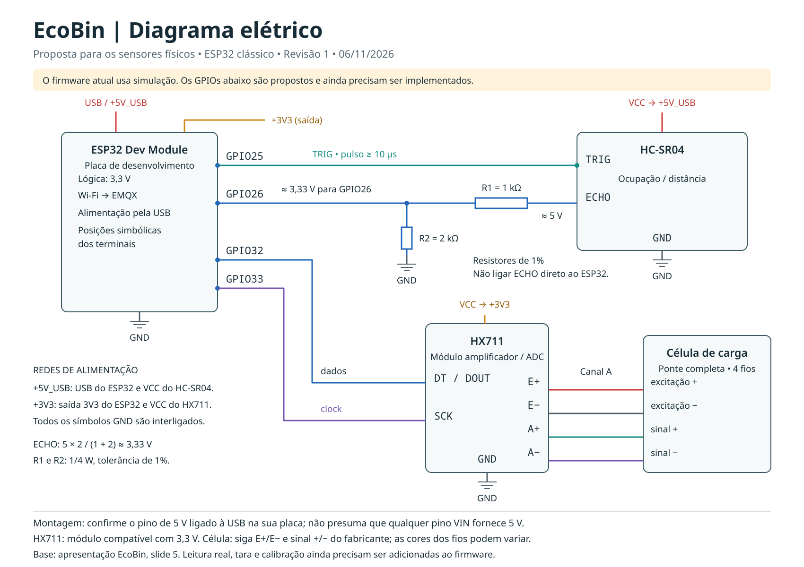

# Diagrama elétrico do EcoBin

Esquema proposto em 06/11/2026 para os componentes previstos no slide 5 da apresentação do projeto: ESP32 clássico, HC-SR04, módulo HX711 e célula de carga de quatro fios em ponte completa. O firmware `ecoBin.ino` ainda simula as leituras e não define os pinos destes sensores. Esta documentação não confirma a montagem física nem altera o firmware.

## Ligações propostas

| Origem | Destino |
| --- | --- |
| USB 5 V | Porta USB da placa ESP32 |
| 5 V da mesma alimentação USB | VCC do HC-SR04 |
| ESP32 GPIO25 | TRIG do HC-SR04 |
| ECHO do HC-SR04 | R1 de 1 kΩ → nó de leitura |
| Nó de leitura | GPIO26 do ESP32 |
| Nó de leitura | R2 de 2 kΩ → GND |
| ESP32 3V3 | VCC do módulo HX711 compatível com 3,3 V |
| HX711 DT / DOUT | ESP32 GPIO32 |
| ESP32 GPIO33 | HX711 SCK / PD_SCK |
| HX711 E+ / E− | Excitação + / − da célula |
| HX711 A+ / A− | Sinal + / − da célula |
| GND do ESP32, HC-SR04 e HX711 | Terra comum |

O desenho mostra terminais simbólicos; a posição física depende da placa. Confirme a identificação GPIO na serigrafia. Para alimentar o HC-SR04, confirme qual pino da placa fornece os 5 V da USB; não presuma que um pino VIN tenha essa função. Use uma única alimentação USB neste esquema.

R1 fica entre ECHO e o nó de leitura; R2 fica entre esse nó e GND. Use resistores de 1/4 W e tolerância de 1%. Com ECHO em 5 V, o divisor fornece aproximadamente `5 × 2 / (1 + 2) = 3,33 V`. O ECHO não deve ser ligado diretamente ao GPIO.

O esquema assume um módulo HX711 de alimentação única compatível com 3,3 V. Se o seu módulo possui VCC e VDD separados, consulte o esquema dele: a alimentação digital VDD deve acompanhar os 3,3 V do ESP32. As cores da célula variam conforme o fabricante; identifique excitação e sinal pelo datasheet, sem usar somente a cor do fio. Uma célula de três fios exige outra configuração.

Após a montagem será necessário implementar a leitura dos sensores, a tara e a calibração da célula de carga no firmware.

## Referências

- Base do projeto: `apresentacao/output/EcoBin_ScriptBoys_atualizado.pptx`, slide 5; `ecoBin.ino` e `README.md`.
- [Espressif — ESP32-WROOM-32, características elétricas](https://documentation.espressif.com/esp32-wroom-32_datasheet_en.html): níveis de entrada referidos à alimentação de 3,3 V.
- [ElecFreaks — HC-SR04, datasheet](https://cdn.sparkfun.com/datasheets/Sensors/Proximity/HCSR04.pdf): alimentação de 5 V e pulso TRIG TTL de pelo menos 10 µs.
- [AVIA Semiconductor — HX711, datasheet](https://cdn.sparkfun.com/datasheets/Sensors/ForceFlex/hx711_english.pdf): alimentação e interface DOUT/PD_SCK; alimentação digital igual à do microcontrolador.

Arquivos: `diagrama-eletrico-ecobin.png` para apresentação e `diagrama-eletrico-ecobin.svg` para edição vetorial.
